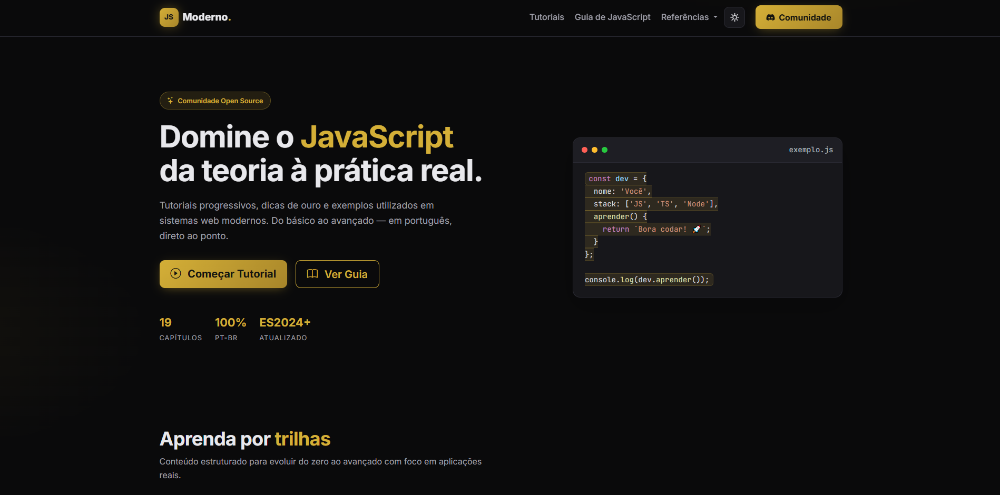
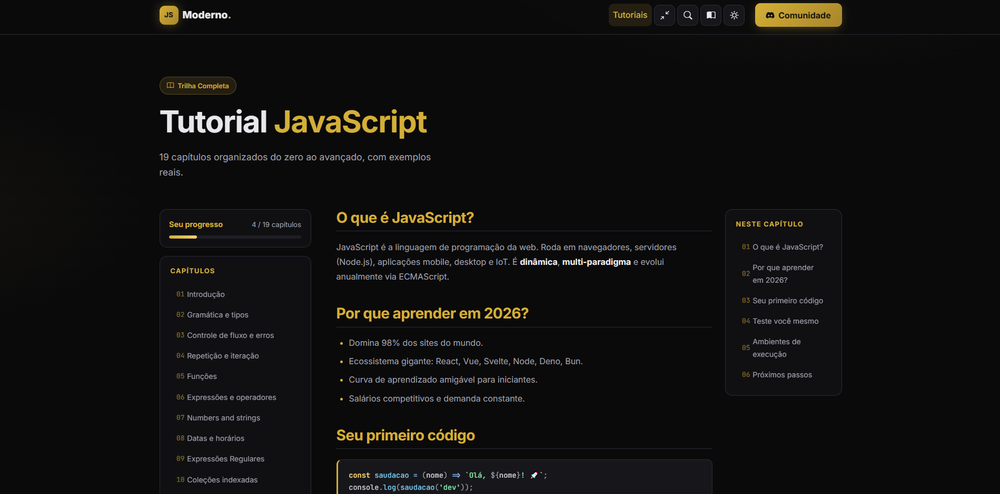

<div align="center">

# 🚀 JavaScript Moderno

**Comunidade de estudos de JavaScript — tutoriais, guias e práticas reais utilizadas em sistemas web modernos.**

[](https://github.com/Alisson-aguiar/javascript-moderno/actions/workflows/ci.yml)
[](https://opensource.org/licenses/MIT)
[](https://developer.mozilla.org/pt-BR/docs/Web/JavaScript)
[](https://nodejs.org/)
[](https://www.docker.com/)
[](http://makeapullrequest.com)

[📖 Tutorial](https://github.com/Alisson-aguiar/javascript-moderno) · [🐛 Reportar bug](../../issues) · [💡 Sugerir feature](../../issues)

</div>

---

## 📌 Sobre o projeto

**JavaScript Moderno** é uma plataforma de estudo interativa em português que une **teoria e prática** do JavaScript moderno. Do básico ao avançado, com **19 capítulos estruturados**, exemplos executáveis, busca instantânea, anotações pessoais e modo apresentação.

> 🎯 **Objetivo:** ser um recurso completo e profissional para quem quer dominar JavaScript com foco no que é usado na vida real de sistemas web.

### ✨ Destaques

- 📚 **19 capítulos** organizados do zero ao avançado
- 🎨 **Design moderno** com tema dark/light e paleta gold
- 🔍 **Busca instantânea** (`Ctrl + K`) em todos os capítulos
- ▶️ **Playground interativo** para executar código direto no navegador
- 📊 **Progresso do usuário** salvo em `localStorage`
- 📝 **Anotações pessoais** por capítulo com export/import
- 🖼️ **Modo apresentação** (slides gerados a partir dos capítulos)
- 🔗 **Links contextuais para MDN** automaticamente
- 📱 **PWA instalável** com suporte offline
- ⌨️ **Atalhos de teclado** para navegação rápida

---

## 🖼️ Preview

<div align="center">

| Home | Tutorial | Playground |
|:---:|:---:|:---:|
|  |  |

> 💡 Substitua as imagens acima por screenshots reais do projeto.

</div>

---

## 🛠️ Stack técnica

| Camada | Tecnologia |
|--------|-----------|
| **Frontend** | HTML5, CSS3, JavaScript ES2024+ |
| **UI Framework** | [Bootstrap 5](https://getbootstrap.com/) + [Bootstrap Icons](https://icons.getbootstrap.com/) |
| **Syntax Highlight** | [Prism.js](https://prismjs.com/) |
| **Servidor Web** | [Nginx](https://nginx.org/) (Alpine) |
| **Container** | [Docker](https://www.docker.com/) + Docker Compose |
| **HTTPS Local** | [mkcert](https://github.com/FiloSottile/mkcert) |
| **Lint / Format** | [Biome](https://biomejs.dev/) |
| **Testes unitários** | [Vitest](https://vitest.dev/) + [jsdom](https://github.com/jsdom/jsdom) |
| **Testes E2E** | [Playwright](https://playwright.dev/) |
| **Git Hooks** | [Husky](https://typicode.github.io/husky/) + [lint-staged](https://github.com/lint-staged/lint-staged) |
| **CI/CD** | [GitHub Actions](https://github.com/features/actions) |
| **Deploy** | [Vercel](https://vercel.com/) |

---

## 🚀 Rodando localmente

### Pré-requisitos

- [Docker Desktop](https://www.docker.com/products/docker-desktop/) instalado e rodando
- [Git](https://git-scm.com/) instalado
- [Node.js 22+](https://nodejs.org/) (opcional, para rodar scripts de dev)

### Com Docker (recomendado)

```bash
# 1. Clone o repositório
git clone https://github.com/Alisson-aguiar/javascript-moderno.git
cd javascript-moderno

# 2. Gere os certificados HTTPS locais (uma vez só)
mkcert -install
mkdir -p certs
mkcert -key-file certs/localhost-key.pem \
       -cert-file certs/localhost.pem \
       localhost 127.0.0.1 ::1

# 3. Suba os containers
docker compose up -d
```

Acesse: **https://localhost:8443**

### Sem Docker (dev rápido)

```bash
npm install
npx serve .
```

Acesse: **http://localhost:3000**

---

## 🧪 Testes e qualidade

```bash
# Lint + formatação (Biome)
npm run check

# Testes unitários (Vitest)
npm run test

# Testes unitários com cobertura
npm run test:coverage

# Testes E2E (Playwright)
npm run test:e2e

# Todos os testes
npm run test:all

# Gerar sitemap
npm run sitemap
```

### Pre-commit hooks

O projeto usa **Husky + lint-staged** para rodar verificação em cada commit. Se algo falhar, o commit é bloqueado automaticamente.

---

## 📂 Estrutura do projeto

```
javascript-moderno/
├── .github/
│   └── workflows/
│       └── ci.yml                 # GitHub Actions - lint, testes e build
├── assets/
│   ├── css/
│   │   ├── style.css              # Estilos globais + temas
│   │   └── prism-theme.css        # Tema customizado do Prism
│   ├── data/
│   │   └── search-index.json      # Índice de busca (gerado)
│   ├── img/
│   │   └── icon.svg               # Ícone do PWA
│   └── js/
│       ├── app.js                 # Boot da home
│       ├── router.js              # SPA router + parser Markdown
│       ├── search.js              # Busca instantânea
│       ├── theme-toggle.js        # Alternar dark/light
│       ├── playground.js          # Execução de código inline
│       ├── pwa-register.js        # Registro do Service Worker
│       ├── progress.js            # Progresso do usuário
│       ├── notes.js               # Anotações por capítulo
│       ├── presenter.js           # Modo apresentação
│       ├── focus-mode.js          # Modo foco
│       ├── mdn-links.js           # Links automáticos para MDN
│       ├── feedback.js            # Feedback por capítulo
│       └── share.js               # Compartilhar capítulo
├── content/                       # 19 capítulos em Markdown
│   ├── 01-introducao.md
│   ├── 02-gramatica.md
│   └── ... (até 19-modules.md)
├── scripts/
│   ├── build-search-index.mjs     # Gera índice de busca
│   └── generate-sitemap.mjs       # Gera sitemap.xml
├── tests/
│   ├── setup.js                   # Setup global (jsdom mocks)
│   ├── unit/                      # Testes unitários (Vitest)
│   └── e2e/                       # Testes E2E (Playwright)
├── .dockerignore
├── .gitignore
├── biome.json                     # Configuração do Biome
├── docker-compose.yml             # Web + HTTPS local
├── Dockerfile                     # Build multi-stage
├── index.html                     # Home
├── manifest.webmanifest           # PWA manifest
├── nginx.conf                     # Config produção (HTTP)
├── nginx-https.conf               # Config dev local (HTTPS)
├── package.json
├── README.md
├── robots.txt
├── sw.js                          # Service Worker
└── tutorial.html                  # SPA do tutorial
```

---

## ⌨️ Atalhos de teclado

| Tecla | Ação |
|-------|------|
| `Ctrl + K` | Abrir busca |
| `P` | Modo apresentação |
| `F` | Modo foco |
| `Ctrl + Shift + C` | Compartilhar capítulo |
| `Esc` | Fechar overlay / sair |
| `←` `→` | Navegar slides |
| `Ctrl + Enter` | Executar playground |

---

## 🐳 Comandos Docker úteis

```bash
# Subir todos os serviços
docker compose up -d

# Ver status
docker compose ps

# Ver logs em tempo real
docker compose logs -f web

# Rebuild após mudanças
docker compose up -d --build

# Parar tudo
docker compose down

# Entrar no container
docker compose exec web sh

# Ver tamanho da imagem
docker images javascript-moderno
```

---

## 🔐 Segurança e boas práticas

- ✅ Headers de segurança (`X-Content-Type-Options`, `X-Frame-Options`, `Referrer-Policy`)
- ✅ HSTS ativo em HTTPS (`Strict-Transport-Security`)
- ✅ Compressão gzip para assets estáticos
- ✅ Cache diferenciado por tipo de recurso
- ✅ Certificados locais **nunca** versionados (`.gitignore`)
- ✅ CI roda lint + testes antes de qualquer merge
- ✅ Imagem Docker multi-stage (~25MB)

---

## 🤝 Como contribuir

1. Faça um **fork** do projeto
2. Crie uma branch: `git checkout -b feature/minha-feature`
3. Commit suas mudanças: `git commit -m 'feat: adiciona nova funcionalidade'`
4. Push para a branch: `git push origin feature/minha-feature`
5. Abra um **Pull Request**

### Convenção de commits

Este projeto segue [Conventional Commits](https://www.conventionalcommits.org/):

- `feat:` nova funcionalidade
- `fix:` correção de bug
- `docs:` documentação
- `style:` formatação
- `refactor:` refatoração
- `test:` testes
- `ci:` CI/CD
- `chore:` tarefas gerais

---

## 📚 Referências

- [MDN Web Docs - JavaScript](https://developer.mozilla.org/pt-BR/docs/Web/JavaScript)
- [ECMAScript 2024](https://tc39.es/ecma262/)
- [Docker Docs](https://docs.docker.com/)
- [GitHub Actions](https://docs.github.com/en/actions)
- [Biome](https://biomejs.dev/) · [Vitest](https://vitest.dev/) · [Playwright](https://playwright.dev/)

---

## 📄 Licença

Este projeto está sob a licença **MIT**. Veja [LICENSE](LICENSE) para mais detalhes.

---

<div align="center">

**⭐ Se este projeto te ajudou, considera dar uma estrela!**

Feito com ❤️ e muito ☕ por [Alisson Aguiar](https://github.com/Alisson-aguiar)

</div>